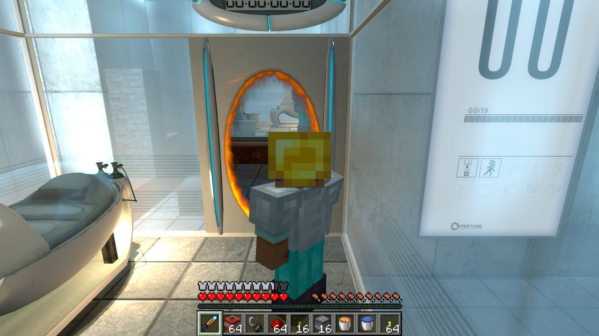
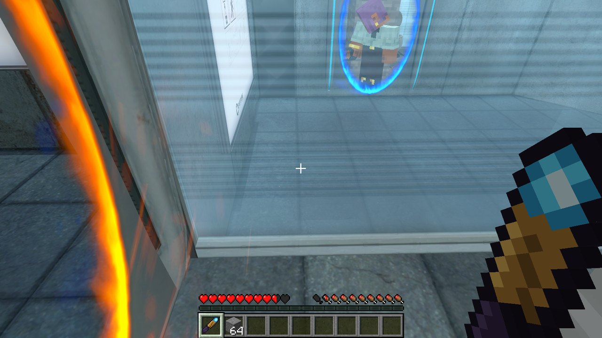
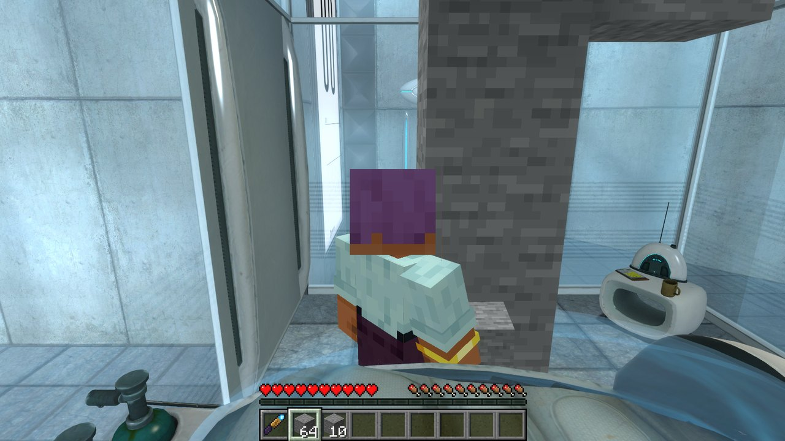
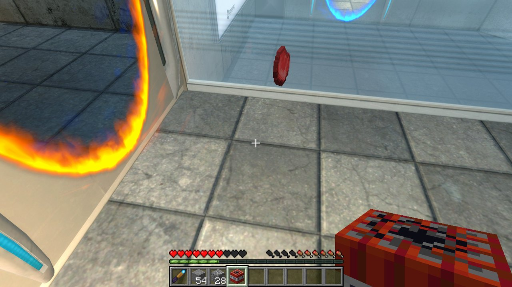

# PortalCraft

Play **Portal as Steve**: Minecraft's movement, inventory, HUD, blocks, mobs and TNT inside real
Steam Portal, with Portal's own portals, cubes, buttons and turrets. Plus a portal gun for plain
Minecraft 26.3 (Fabric).



| | |
|---|---|
|  |  |
| Steve, seen through one of Portal's portals | Minecraft blocks built in a test chamber |
|  | |
| Mobs and TNT next to Portal's portals | |

## The portal gun in plain Minecraft

Fire two linked portals onto any solid surface and walk, fall or fling through them, with momentum
carried through.

| Input | Does |
|---|---|
| Left click | Fire the blue (primary) portal |
| Right click | Fire the orange (secondary) portal |

- Portals are 1×2 blocks and need two solid faces in a row with open space in front.
- Each player has their own pair. Firing a colour again moves that portal.
- Breaking a block behind a portal fizzles it.
- As in Portal, a linked portal opens a hole in the blocks behind it: you walk (or fall) into it
  and come out of the other one the moment your centre crosses its surface. Coming at it too far
  off to the side to fit, you go through on touching it.
- Items, mobs and arrows go through too.
- Get it from the Tools & Utilities creative tab, or craft it:

```
 . E A      E = ender pearl   A = amethyst shard
 . G E      G = gold ingot    O = obsidian
 O . .
```

## Setting up a new PC

You need Windows, Git, and Steam Portal if you want the Portal side. Nothing is installed
system-wide.

```bat
git clone https://github.com/GongerNonger/portalcraft.git
cd portalcraft
play-portal.cmd
```

The first run of `tools\setup.ps1` does three things:
- downloads a portable JDK 25 into `.jdk\`;
- creates the void world in `run\saves\PortalCraft`;
- finds Portal through Steam's library list and installs the plugin into `portal\addons\`. It
  builds the plugin if Visual Studio 2022 Build Tools are present, and otherwise uses
  `host\portal\prebuilt\portalcraft.dll`.

## Releases for friends

Friends download `PortalCraft-Setup.exe` from the newest
[release](https://github.com/GongerNonger/portalcraft/releases/latest), run it, and from then on
use the **PortalCraft** shortcut it puts on their desktop. The setup installs the plugin into Steam
Portal and a portable Prism Launcher with the PortalCraft instance (Minecraft 26.3, Fabric, Fabric
API, the mod, the voxel portal gun, the void world) into `%LOCALAPPDATA%\PortalCraft`, and points
`portalcraft.ini` at it. The first start opens Prism to sign in with a Microsoft account that owns
Minecraft; after that Minecraft starts hidden with Portal.

The shortcut keeps them current: it asks GitHub for the newest release, installs it if it is newer
than theirs (the sign-in, the world and every setting are kept), and then starts Portal.

Shipping an update:

```bat
:: 1. raise version= in gradle.properties (0.2.0 -> 0.2.1): the shortcut compares these numbers
powershell -ExecutionPolicy Bypass -File tools\package.ps1
git commit -am "0.2.1" && git tag v0.2.1 && git push origin main v0.2.1
gh release create v0.2.1 dist\PortalCraft-Setup.exe dist\PortalCraft-0.2.1.zip dist\portalcraft-0.2.1.jar --title "PortalCraft 0.2.1" --notes "what changed"
```

`tools\package.ps1` builds both halves and writes the three files to `dist\`: the setup program
(the zip inside a self-extracting program made with Windows' IExpress), the zip itself (unzip and
run `Install PortalCraft.cmd`), and the mod's jar. To try an install without touching the real
Portal or `%LOCALAPPDATA%`, set `PORTALCRAFT_PORTAL` and `PORTALCRAFT_HOME` to scratch folders first.

## Playing with friends

Friends can be in the same chamber as Steves. One hosts and the others join: the **PortalCraft with
friends** shortcut asks which, and keeps the answer.

- **Host**: your Minecraft world is opened to the network on port 25590. On the same network your
  friends join the address the dialog shows; over the internet they need a public address for that
  port (a tunnel such as playit.gg, or a port forward on your router).
- **Join**: type the host's address. Start after they have. Your Portal goes to whatever chamber
  theirs is in, and follows it from level to level.

Everyone is in one Minecraft world: you see each other, and blocks, mobs and items are shared. Each
player's Portal is still its own copy of the chamber, so cubes, doors, buttons and portals are
separate for now: a friend can't stand on your button or walk through your portals.

In `portalcraft.ini` this is a `[Friends]` section with `host_port=25590` or
`join=address:port`. Two players can be run on one PC for testing (`tools/devtests/coop.sh`).

## Extras: the green portal

Two switches, run from this repository (they need [uv](https://docs.astral.sh/uv/) and build
everything from your own Portal, so nothing of Valve's is in here). Portal reads them when it
starts: restart it after.

```bat
opening on          :: chamber 00 opens with Steve dropping out of a green portal in the vault's ceiling
opening off         :: ... or as Valve made it, waking up in the bed
green-portals on    :: every portal a turning green spiral with globs round its rim
green-portals off   :: Portal's own blue and orange
```

The opening's portal sounds are `open.wav`, `pass.wav` and `close.wav` in `tools/intro` (samples of
Rick and Morty's portal sound). Delete them and `tools/intro/sounds.py` synthesizes its own.

## Building

```bat
gradle build               :: jar in build\libs (gradle.cmd = gradlew with the portable JDK)
gradle runClient           :: dev Minecraft with the mod, offline as "Steve"
host\portal\build.cmd      :: the Portal plugin (needs VS 2022 Build Tools, x86)
```
`tools\make_textures.py` regenerates the art (`uv run --no-project --with pillow python tools/make_textures.py`).

## Playing inside Portal

Steve's Minecraft movement inside real Steam Portal. A hidden-in-plain-sight Minecraft runs the
physics; Portal draws everything and keeps its own portal gun, portals and teleports.

1. `play-portal.cmd` builds and installs the Portal plugin the first time (into
   `Portal\portal\addons\`), then starts Portal. The plugin starts Minecraft itself, hidden
   (void world `PortalCraft`, about a minute; Portal's top-left corner says how it's going), and
   Minecraft saves and quits when Portal closes. What it starts is in
   `Portal\portal\addons\portalcraft.ini`; `start_with_portal=0` there to start Minecraft yourself.
2. Click into the Portal window. WASD/space/shift/ctrl go to Minecraft; the mouse is Portal's.
3. Walk into a pair of open portals: Portal teleports you, Minecraft follows with your momentum.

How it fits together:

| | Portal (`host/portal`, 32-bit server plugin) | Minecraft (`dev.portalcraft.host`) |
|---|---|---|
| Position | follows Minecraft every movement tick (`GameMovement001` hook) | runs the physics |
| Walls | — | reads the map's `.bsp` brushes as collision; linked portals cut holes |
| Look | the mouse, natively | copies Portal's view angles |
| Portals | fires and renders its real ones; teleports the player | follows each teleport (seq/ack) |
| Keys | reads WASD etc. while its window has focus | replays them as its own input |
| Clicks | fires its gun while Steve holds the portal gun | otherwise attacks/places/picks; aims at the map's walls too, and a block placed against a wall goes in the cell in front of it (to the nearer half-cell, since walls don't sit on the block grid) |
| Body | hides Chell (render mode) | in third person (F5) sends Steve, posed, with his skin and what he holds; Portal draws him at its player's feet |
| F5 | moves its camera behind/in front of the player (client-mode `OverrideView` hook, no cheats), stopped by its walls | cycles the view as usual; sends how far its own camera gets, so the host's stops at placed blocks too |

### Playing as your own skin

- **Installed from a release:** nothing to do. You signed in to Minecraft in Prism, so you play as
  the skin on your Minecraft account. Change it the usual way (minecraft.net or the official
  launcher) and it follows.
- **Any skin you like, account or not:** save the skin as a PNG (the standard 64x64 skin file, the
  kind skin sites let you download) under one of these names, then restart:
  - `portalcraft-skin.png` for the wide-armed (Steve) model
  - `portalcraft-skin-slim.png` for the slim-armed (Alex) model

  in the `config` folder: `%LOCALAPPDATA%\PortalCraft\Prism\instances\PortalCraft\.minecraft\config` for a
  release install, `run\config` in this repository for the dev client. Delete the file to go back.

It is the skin you see in third person (F5), through portals, and in the chamber 00 opening.

Link: UDP on 127.0.0.1 ports 27515/27516, layout in `protocol/portalcraft_protocol.h`.
Logs: `Portal\portal\addons\portalcraft.log` and Minecraft's `run\logs\latest.log`.
Dev tools: `host\portal\tools\fake_mc.py` (stand-in for Minecraft, `--cmd` console commands,
`--keys` test input). With `-portalcraftdev` the plugin keeps the last 15 minutes of play and
writes them out as each level ends (`addons\replay-auto-<map>-<time>.txt`); `--dump-replay NAME`
writes them on demand, and `--replay FILE --replay-check` plays one back and says how far the
replay parted from the recording.

Tests: `docs/TESTING.md`. Scripted checks (`tools/devtests`) drive a running pair through portals,
lifts, carts, cubes, turrets and the late-game hazards, most of them in a test chamber of our own
(`tools/testmap`, compiled with Portal's map tools), and one counts gold pixels in a screenshot to
make sure Portal is drawing Minecraft's blocks at all.

Camera smoothness: Portal's single-player client doesn't predict the player (`cl_predict` is
forced to 0), so its camera follows the server through network interpolation. At Portal's
defaults (20 updates/s, 100 ms delay) that beats against Minecraft's 20 Hz ticks and the view
bobs. `play-portal.cmd` launches Portal with `+cl_updaterate 66 +cl_cmdrate 66 +cl_interp 0
+cl_interp_ratio 1` (one update per server tick, ~15 ms delay), which removes the bob.

Scale: one block is 32 of Portal's units, so its 64-unit building grid is two blocks and a block
placed on a chamber floor sits flush on it. Steve is scaled up by 1.25 inside Portal (2.25 blocks,
Portal's 72 units), with his speed, jump, step and reach scaled to match.

Known gaps (see `docs/PORTAL_MECHANICS.md` for what works):
- Portals can't be placed on Minecraft's blocks (a shot at your wall fizzles on it, as on Portal's
  black walls).
- Standing on something that spins doesn't turn Steve with it. Portal's maps have nothing of the
  kind to stand on (fans, and GLaDOS's disks).
- Friends share the Minecraft world but not Portal's own things (see Playing with friends).
- After a Portal update, the features that call engine slots checked on today's build (blasts,
  block physics, the health kill, corner messages) turn themselves off until they're re-checked
  (`docs/PORTAL_MECHANICS.md`, "After a Portal update").

## Host-game bridges

`PortalGunEvents.FIRE` lets another mod take over a shot. A bridge to a host game (Portal, HL2, ...)
returns `true` and makes the host fire its own real portal instead. See `docs/PORTAL_RTX_RESEARCH.md`
for the Portal / Portal with RTX plan.

Portals here are opaque ovals. Seeing through them is left to the host game, which already renders
real portals.

## License

PortalCraft is MIT-licensed (`LICENSE`): use it, change it, share it, as long as the copyright
notice stays with it. Parts follow SkyCraft (MIT) and releases bundle Prism Launcher (GPL-3.0) and
Fabric API (Apache-2.0); see `THIRD-PARTY-NOTICES.md`. Not affiliated with Valve, Mojang or
Microsoft: you need to own Portal and Minecraft: Java Edition.

